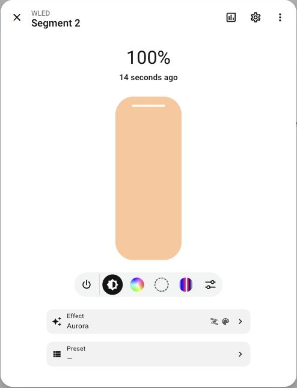
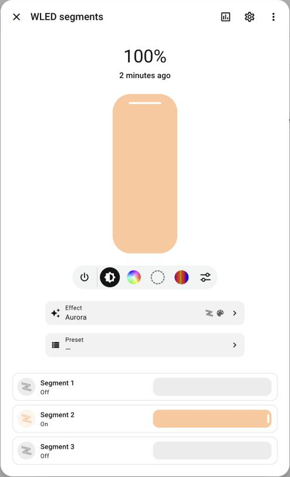
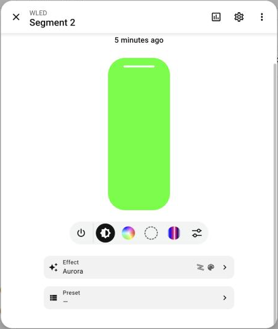
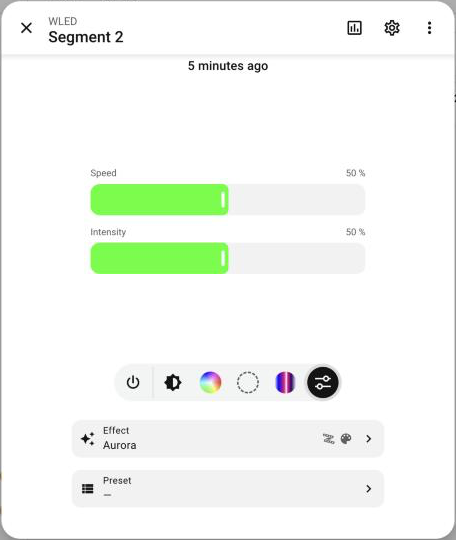
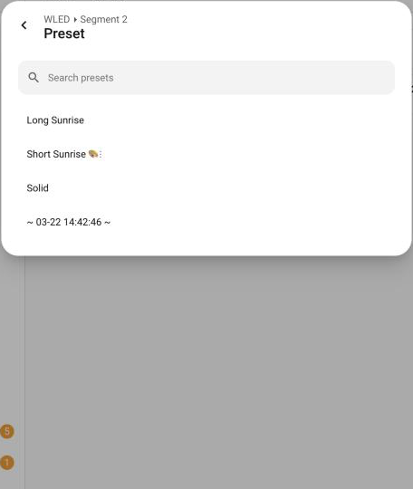
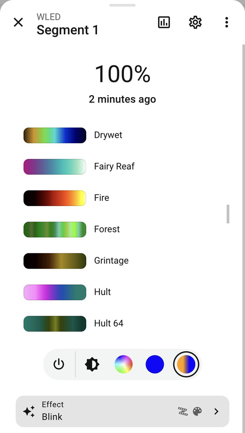
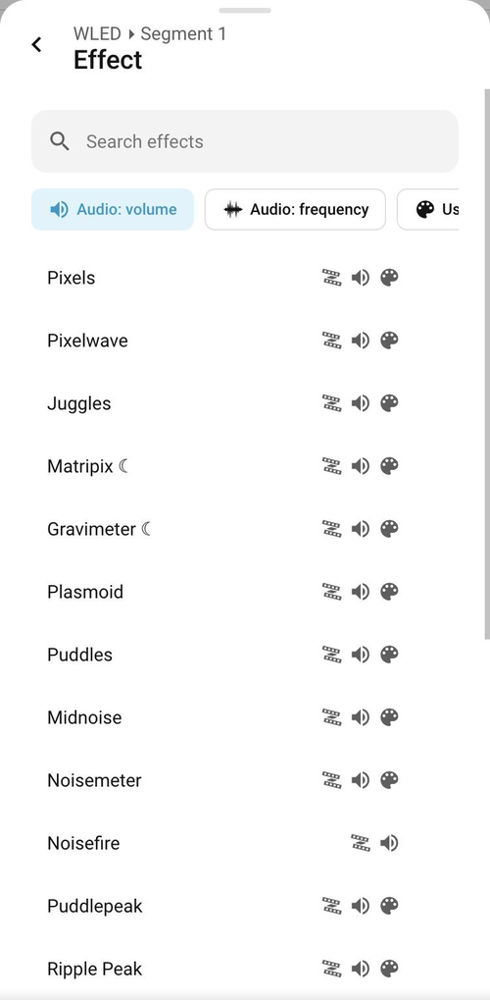

# WLED More-Info

[](https://hacs.xyz/docs/faq/custom_repositories)
[](https://github.com/Cheerpipe/ha-wled-more-info/actions/workflows/validate.yml)
[](https://github.com/Cheerpipe/ha-wled-more-info/actions/workflows/test.yml)
[](LICENSE)

A Home Assistant integration with a **more-info card for
[WLED](https://kno.wled.ge/) lights**: the native light more-info (same header,
brightness slider, color wheel, color temperature and button bar), plus what
Home Assistant's WLED integration doesn't show:

- the **secondary color** (and the tertiary one, when the effect uses it),
- the **palettes with their previews**, like in WLED's own interface,
- the **sliders and options of the current effect**, with WLED's own names
  ("Duty cycle", "Clouds", "Cozy"…), only the ones the effect uses,
- a **searchable effect list grouped like WLED's** (strip, matrix, strip on
  matrix, audio reactive, uses the palette) and the **presets** in the same
  kind of list.

**It replaces the more-info of every WLED light in Home Assistant**: open a
WLED light from any dashboard, the search, the history or the app, and Home
Assistant's own more-info dialog shows the WLED controls. No card to add.
**Light groups** made of WLED segments get it too, and change all their members
at once.

**Home Assistant talks to the device for the card**, so all of it works with
Home Assistant opened over https, in the companion app and away from home. The
browser never calls the WLED device.

Requires Home Assistant **2026.10** or newer and the
[WLED integration](https://www.home-assistant.io/integrations/wled/).

| Any WLED light's more-info                       | A group of WLED lights               |
| ------------------------------------------------ | ------------------------------------ |
|  |  |

| The card                                   | Effect settings                                   | Presets                                              |
| ------------------------------------------ | ------------------------------------------------- | ---------------------------------------------------- |
|     |  |              |
| **Palettes with previews**                 | **Effects**                                       | **Effects filtered by category**                     |
|  |           |  |

## Installation

1. **HACS:** add this repository as a custom repository (type _Integration_),
   install _WLED More-Info_ and restart Home Assistant.
   **Manual:** copy `custom_components/wled_more_info` into your
   `config/custom_components/` folder and restart.
2. **Settings → Devices & services → Add integration → WLED More-Info** and
   leave **Use the WLED card in every WLED light's more-info** on. It works
   with every device of the WLED integration.
3. Reload the browser (in the app: close and reopen it). That's it: every WLED
   light's more-info now shows the WLED controls. The card is loaded on every
   page by the integration; no dashboard resource is needed.

The option can be changed later in the integration's **Configure** button.
With it off, the more-info stays native and the card is only where you add it.

If you used the WLED card from
[More-Info Popup Card](https://github.com/Cheerpipe/ha-more-info-popup-card)
0.5 / 0.6, update that card to 0.7 or newer, which no longer includes it.
Your dashboards keep working: the `type` is the same.

## Everywhere: the native more-info

With the option on, Home Assistant's own more-info dialog of these lights
shows the WLED controls instead of the native light controls:

- **WLED segment lights** (`light.wled`, `light.wled_segment_1`…).
- **Light groups whose members are all WLED segment lights**, even from
  different WLED devices. Effect, colors, secondary color, palette, speed,
  intensity and the effect's options go to every member; the members are
  still listed below, like in the native dialog. The preset row shows when all
  members are on the same device.
- **[Relative Light Group](https://github.com/Cheerpipe/ha-relative-light-group)**
  groups of WLED segments too. They follow that integration's rule: colors,
  effects and the WLED settings go only to the members that are on (to all of
  them when every member is off), and the card shows the first member that is
  on.
- **Groups of groups**, at any depth and mixing both kinds (for example a
  Relative Light Group of two light groups of WLED segments). Each group
  applies its own rule on the way down, and the card shows the first WLED
  light reached that is on.

Everything else in the dialog stays native: header, history, settings, the ⋮
menu, related, and every other entity. The WLED "main" light (brightness only)
keeps the native controls.

## The card

```yaml
type: custom:more-info-wled-state-card
entity: light.wled_segment_1
show_state: true # header with the brightness and the last change
show_last_changed: true
show_effects: true # effect and preset rows
appearance: plain # plain (like more-info) | card
```

The same controls as a card, for dashboards and popups. Everything is also in
the visual editor. `entity` is a **WLED segment light** (`light.wled`,
`light.wled_segment_1`…) or a **light group of them** (Home Assistant's
light groups or [Relative Light Group](https://github.com/Cheerpipe/ha-relative-light-group)). The "main" light WLED
creates for multi-segment devices only has a brightness, so it gets the plain
power and brightness controls, like the native more-info.

### The button bar

Like the light more-info, the round buttons under the main control switch what
it shows:

| Button             | Main control                                                                                                                                                    |
| ------------------ | --------------------------------------------------------------------------------------------------------------------------------------------------------------- |
| ⏻                  | turns the segment on / off                                                                                                                                      |
| brightness         | the native brightness slider                                                                                                                                    |
| color wheel        | the native color wheel (primary color)                                                                                                                          |
| **filled circle**  | **secondary color**: a color wheel for WLED's second color slot. With effects that use a third color, the wheel switches between both; ⊘ sets the slot to black |
| color temperature  | the native color temperature picker, for segments that have it                                                                                                  |
| **palette swatch** | **palettes**: every palette with its preview. The `*` palettes are drawn with the segment's colors                                                              |
| **sliders**        | **effect settings**: speed, intensity and the effect's own sliders and options, named like in WLED                                                              |

The secondary color and palette buttons are disabled when the current effect
doesn't use them, like WLED hides them in its own interface.

Under the button bar, the light's **favorite colors**, like in the native
more-info: tap one to apply it; administrators long-press to add, edit, reorder
or delete them. They are the same favorites as Home Assistant's own dialog.

### Effects and presets

Under the button bar there are two rows: **Effect** (with the effect's
categories) and **Preset**. Each opens a searchable list: inside a popup as a
native sub-view with a back arrow, on a dashboard right below the row. The
effect list can be filtered by category:

| Icon (Material Design) | Category                                              |
| ---------------------- | ----------------------------------------------------- |
| LED strip              | strip (1D)                                            |
| grid                   | matrix (2D)                                           |
| square outline         | strip effect expanded on a matrix (1.5D, MoonModules) |
| speaker                | audio reactive, volume (needs the audio usermod)      |
| waveform               | audio reactive, frequency                             |
| palette                | uses the palette                                      |

### Inside a More-Info Popup Card popup

With the option on, you don't need a popup for this. To build your own WLED
popup with other cards around the WLED card, use
[More-Info Popup Card](https://github.com/Cheerpipe/ha-more-info-popup-card)
with `entity: this`:

```yaml
type: custom:more-info-popup-card
popup_id: wled_lights
replace_more_info: true
match:
  integration: wled
  domain: light
cards:
  - type: custom:more-info-wled-state-card
    entity: this
```

## How it works

Brightness, the primary color, the effect, the palette, the preset, speed and
intensity go through the WLED integration's entities, like any card. The rest
isn't exposed by the WLED integration, so this integration adds three
websocket commands that the card uses:

| Command                      | What it does                                                                                                                                                   |
| ---------------------------- | -------------------------------------------------------------------------------------------------------------------------------------------------------------- |
| `wled_more_info/catalog`     | Effects, effect metadata (`/json/fxdata`) and palettes with their previews (`/json/palx`). Read once per device and firmware, then kept in memory and on disk. |
| `wled_more_info/state`       | The device's segments (secondary / tertiary colors, custom sliders, options). Reads that arrive together share one request.                                    |
| `wled_more_info/set_segment` | Changes the light's own segment: colors, palette, effect, sliders and options only.                                                                            |

They take the `entity_id` of a WLED light, never an address: requests go
through the WLED integration's own connection to that device, so nothing else
on your network can be reached. Reading needs permission to read the light,
changing it permission to control it.

## Development

```bash
npm install
npm run build      # card → custom_components/wled_more_info/frontend/
npm run typecheck && npm run lint && npm test
npm run test:py    # integration tests (needs uv)
```

The built card is committed, since the integration serves it.

## License

MIT
